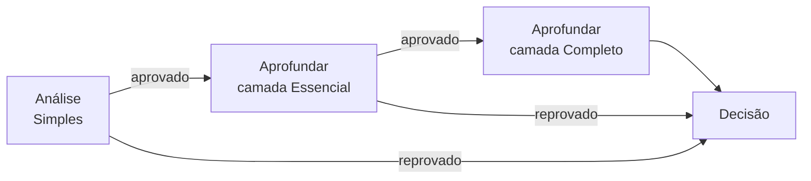

Em vez de pedir o relatório mais caro para todo documento, a esteira começa pelo relatório mais barato e só aprofunda quem passou do filtro anterior.

<Info>
  **Resumo:** monte uma esteira com uma **Análise** no Simples e etapas **Aprofundar** com camadas Essencial e Completo, cada uma com **Executar quando: Se aprovado**. Rode com `POST /operation/run`. Se a política reprova num degrau, os degraus seguintes não rodam. Tudo acontece no mesmo relatório, e a cobrança é a do pacote mais alto que rodou. O resultado chega no [webhook OPERATION](/api-reference/esteiras/webhook-operation).
</Info>

## Como a esteira fica



| Etapa | Política | Executar quando | Para no degrau quando |
| --- | --- | --- | --- |
| Análise | Simples | Sempre | A política do Simples reprova (por exemplo: situação cadastral diferente de ativa, CNAE restrito) |
| Aprofundar | Camada Essencial | Se aprovado | A camada reprova (por exemplo: pessoa politicamente exposta) |
| Aprofundar | Camada Completo | Se aprovado | A camada reprova (por exemplo: processo criminal) |
| Decisão | | Sempre | Consolida, escolhe a rota e monta a oferta |

As regras de parada são as regras das suas políticas: a plataforma não impõe nenhuma. Um degrau que não roda aparece como "não rodou", com o motivo, e não é reprovação por si só: a execução termina com a última decisão registrada.

Como montar as camadas: [Camadas e add-ons](/esteiras/camadas-e-add-ons). Catálogo das etapas: [Etapas](/esteiras/etapas).

## O que é cobrado

O Aprofundar não cria relatório novo: cada camada entra no relatório da Análise. Por isso a execução é cobrada como **um** relatório, pelo pacote de **maior nível** que chegou a rodar nele:

| O que rodou | Cobrança |
| --- | --- |
| Só o Simples (reprovou no primeiro degrau) | Simples |
| Simples e camada Essencial | Essencial |
| Simples, Essencial e Completo | Completo |

- Só conta a camada que terminou de ser aplicada. Uma camada ainda em andamento não sobe o pacote.
- Os add-ons declarados nas camadas são cobrados à parte, como em qualquer relatório.
- Os relatórios dos vínculos (sócios, empresas ligadas) são relatórios próprios e são cobrados cada um pelo seu pacote.

O consumo do dia aparece em **Plano e consumo** já com o pacote da camada mais alta. Valores em [Precificação](/concepts/precificacao).

## Rodar a esteira

```http
POST /operation/run
```

Esta rota não tem o prefixo `/v1`. A organização sai do token. A chave de API da organização pode rodar a esteira.

<ParamField body="document" type="string" required>
  CPF ou CNPJ, com ou sem máscara, inclusive CNPJ alfanumérico. Até 32 caracteres. Precisa ser do tipo que a esteira analisa.
</ParamField>
<ParamField body="operationId" type="string" required>
  Id da esteira. A esteira precisa estar ativa.
</ParamField>
<ParamField body="inputs" type="object">
  Respostas dos dados de entrada da esteira, com a chave do campo e o valor. Só para esteiras que usam [dados de entrada](/esteiras/dados-de-entrada).
</ParamField>

<CodeGroup>
```bash Pedido
curl -X POST https://gyra-core.gyramais.com.br/operation/run \
  -H "Authorization: Bearer {token}" \
  -H "Content-Type: application/json" \
  -d '{
    "document": "43.591.367/0001-30",
    "operationId": "6612a7f30000000000000100"
  }'
```

```json Resposta 200
{
  "reportId": "6612a7f30000000000000300",
  "operationResultId": "6612a7f30000000000000101"
}
```
</CodeGroup>

| Campo da resposta | O que é |
| --- | --- |
| `operationResultId` | Id da execução. É o id que vem em todos os avisos do webhook |
| `reportId` | O relatório raiz, quando a primeira etapa gera relatório |
| `reused` | `true` quando já existia uma execução do mesmo dia, da mesma versão da esteira, do mesmo documento e com os mesmos dados de entrada, que não terminou em erro (em andamento ou já encerrada): nada novo rodou e a resposta aponta para ela. Uma execução reaproveitada não gera aviso novo no webhook |

A execução continua sozinha depois da resposta. Mensagens de recusa (esteira inativa, documento inválido, tipo de documento errado) em [Execuções](/esteiras/execucoes).

## Receber o resultado

Cadastre um webhook do tipo `OPERATION` antes de rodar. O aviso `OPERATION_FINISHED` traz:

- a decisão da esteira (`decision`), com a política e a etapa que decidiram e os motivos;
- a oferta (`offer`), quando a Decisão gera oferta;
- o relatório raiz e os relatórios dos vínculos (`reports`), cada um com o status, o risco e o score de **cada degrau** em `policies`. Um degrau que não rodou não aparece na lista.

Se a esteira para esperando alguém (um analista, a escolha do cliente), você recebe também `OPERATION_WAITING_OPERATOR` ou `OPERATION_WAITING_CUSTOMER`, e `OPERATION_RESUMED` quando ela volta a andar. Payload completo em [Webhook OPERATION](/api-reference/esteiras/webhook-operation).

## Consultar sem webhook

Para conferir uma execução (ou recuperar um aviso perdido), leia as folhas da execução:

```http
GET /operation/result-leafs?operationResultId={id}
```

<ParamField query="operationResultId" type="string" required>
  Id da execução, o mesmo da resposta de `POST /operation/run`.
</ParamField>
<ParamField query="relationshipLevel" type="string">
  Filtra por nível: `ROOT` para o documento analisado, ou um nível de vínculo (`ASSOCIATES`, `FIRST_LEVEL`, `KINSHIP` e outros).
</ParamField>

A resposta é a lista de folhas: uma por etapa e por documento, com `operationStepId`, `status`, `decision`, `reportId`, `relationshipLevel` e o resultado da política de cada folha. O conteúdo do relatório fica em `GET /v2/report/{reportId}`.

## Próximos passos

<CardGroup cols={2}>
  <Card title="Webhook OPERATION" icon="webhook" href="/api-reference/esteiras/webhook-operation">
    Eventos, campos e como deduplicar.
  </Card>
  <Card title="Camadas e add-ons" icon="layer-group" href="/esteiras/camadas-e-add-ons">
    Como criar a camada Essencial e a Completo.
  </Card>
</CardGroup>
